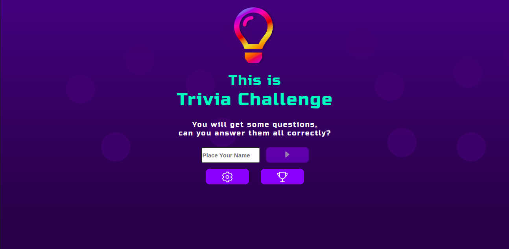
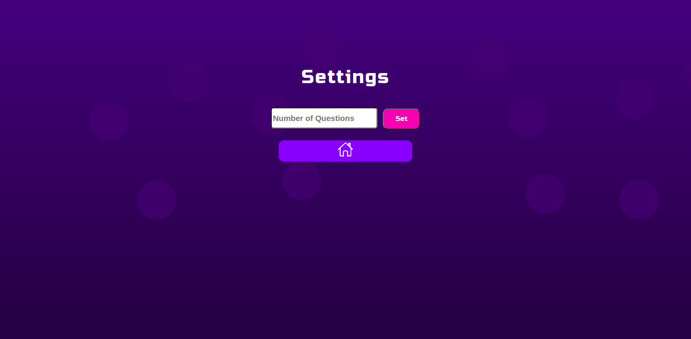
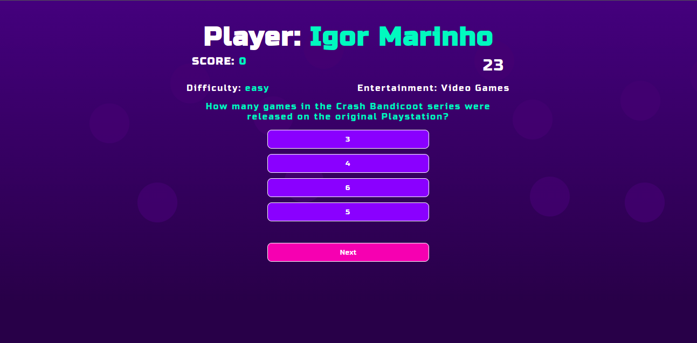
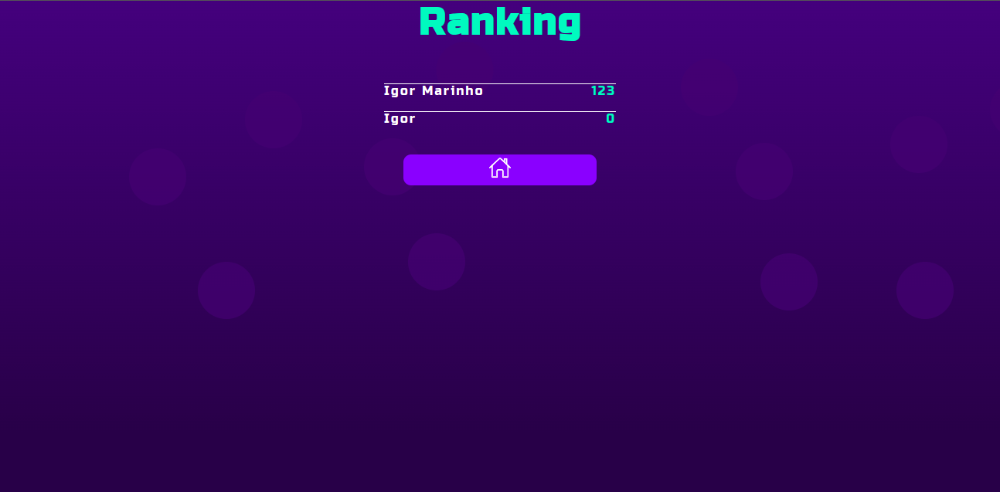

# Trivia Game


🇧🇷 [Leia em português](./README.pt-br.md)

A trivia game built with **React** and **Redux Toolkit**, using questions from the Open Trivia DB API. It started as a team project with Agile methodology and pair programming, where state was managed with classic Redux. After learning Redux Toolkit, I rebuilt the project with it.

**🔗 Live demo: [educational-trivia-game.netlify.app](https://educational-trivia-game.netlify.app/)**

| Login | Settings |
|---|---|
|  |  |
| **Game** | **Ranking** |
|  |  |

## Features

- Login, settings (number of questions), question rounds, feedback screen and ranking
- Questions fetched from the [Open Trivia DB](https://opentdb.com/) API
- Global state with **Redux Toolkit** (slices and store)
- Mobile-first layout with adjustments for larger screens
- Testing Library for tests, ESLint, Stylelint, Husky and Commitizen for code quality

## Tech stack


Also: React Router and Testing Library.

## Running locally

Requirements: Node.js 16 or newer.

```bash
git clone https://github.com/IgorMarinhoArgollo/trivia-game.git
cd trivia-game
npm install
npm start
```

## Credits

Built with [Filipe Onoue](https://github.com/onoue9), [Junio Álves](https://github.com/JunioASilva), [Bruno Philippi](https://github.com/brunophilippi) and [Lucas Toledo](https://github.com/lucas-morais). The design was inspired by [Jeziel Junior's Figma file](https://www.figma.com/community/file/1124158145014892602).

## Author

**Igor Marinho Argollo** · [LinkedIn](https://www.linkedin.com/in/igormarinhoargollo/) · [Portfolio](https://igor-marinho.netlify.app/)

## License

MIT
