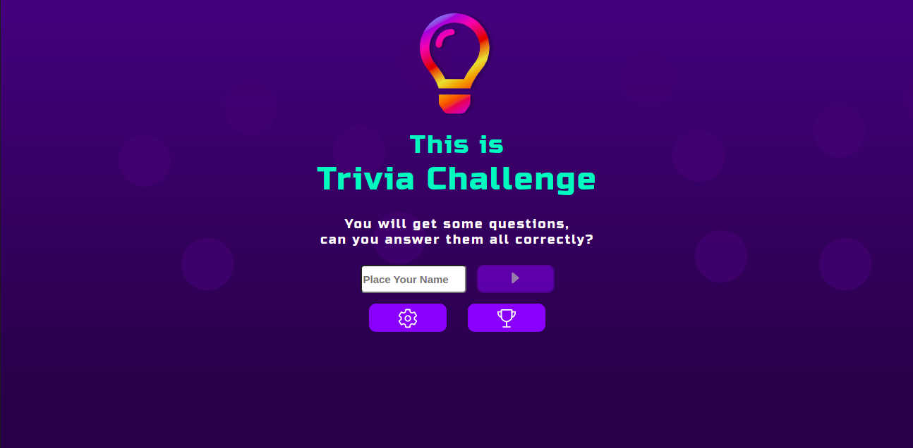
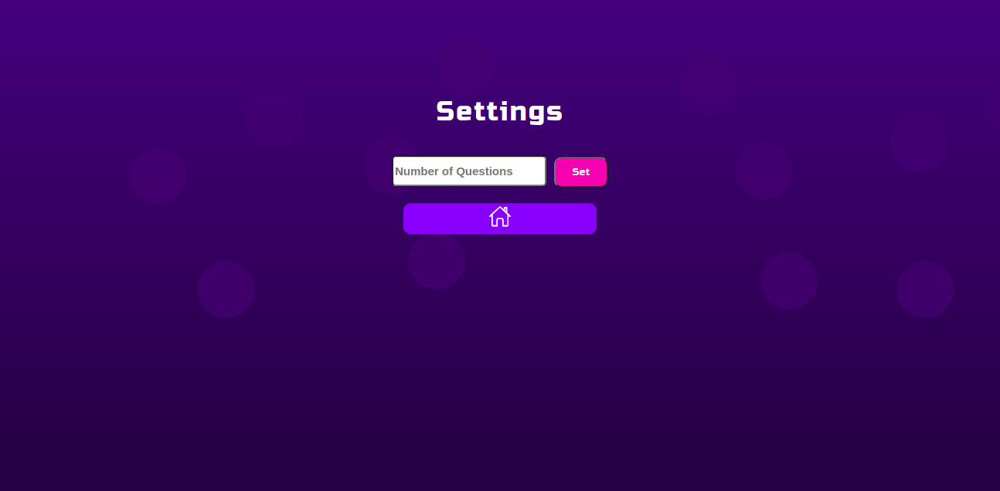
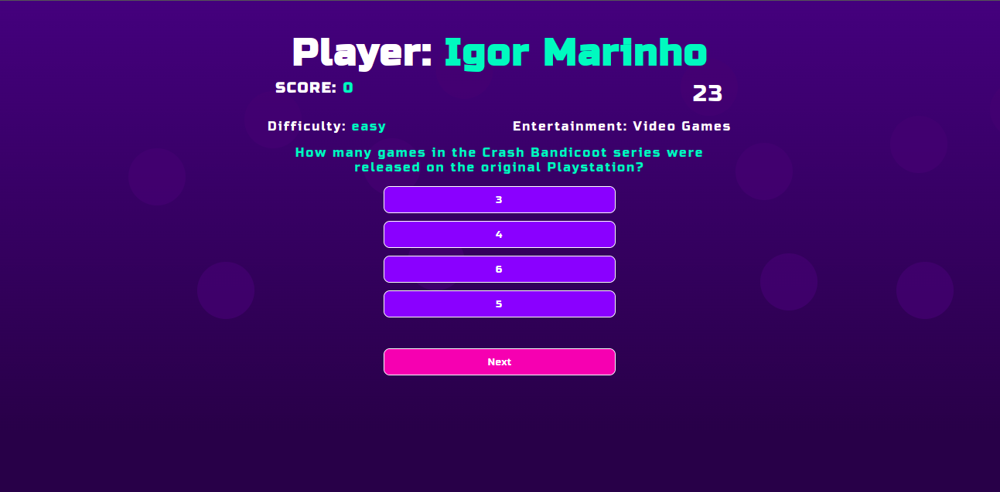
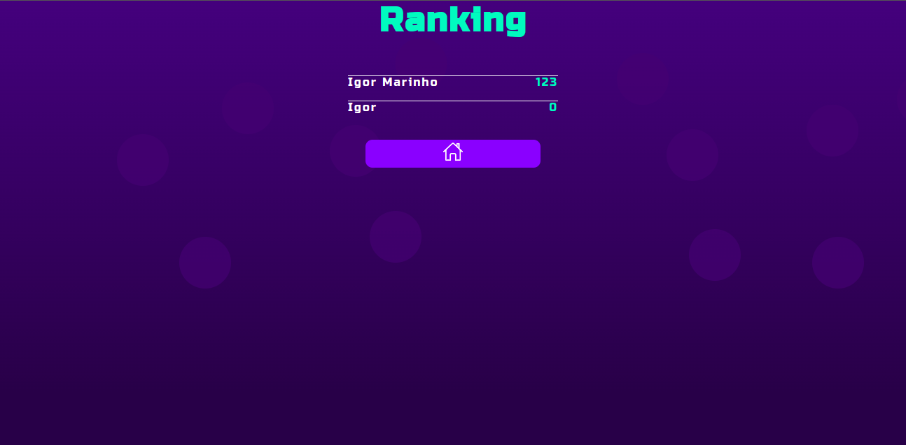

# Trivia Game


🇺🇸 [Read in English](./README.md)

Jogo de perguntas e respostas feito com **React** e **Redux Toolkit**, usando perguntas da API Open Trivia DB. Começou como um projeto em equipe, com metodologia ágil e pair programming, em que o estado era gerenciado com Redux clássico. Depois de aprender Redux Toolkit, refiz o projeto com ele.

**🔗 Demonstração: [educational-trivia-game.netlify.app](https://educational-trivia-game.netlify.app/)**

| Login | Configurações |
|---|---|
|  |  |
| **Jogo** | **Ranking** |
|  |  |

## Funcionalidades

- Login, configurações (número de perguntas), rodadas de perguntas, tela de feedback e ranking
- Perguntas buscadas na API [Open Trivia DB](https://opentdb.com/)
- Estado global com **Redux Toolkit** (slices e store)
- Layout mobile first, com ajustes para telas maiores
- Testing Library para testes, ESLint, Stylelint, Husky e Commitizen para qualidade de código

## Tecnologias


Também: React Router e Testing Library.

## Como rodar

Requisito: Node.js 16 ou superior.

```bash
git clone https://github.com/IgorMarinhoArgollo/trivia-game.git
cd trivia-game
npm install
npm start
```

## Créditos

Feito com [Filipe Onoue](https://github.com/onoue9), [Junio Álves](https://github.com/JunioASilva), [Bruno Philippi](https://github.com/brunophilippi) e [Lucas Toledo](https://github.com/lucas-morais). O design foi inspirado no [arquivo do Figma de Jeziel Junior](https://www.figma.com/community/file/1124158145014892602).

## Autor

**Igor Marinho Argollo** · [LinkedIn](https://www.linkedin.com/in/igormarinhoargollo/) · [Portfólio](https://igor-marinho.netlify.app/)

## Licença

MIT
